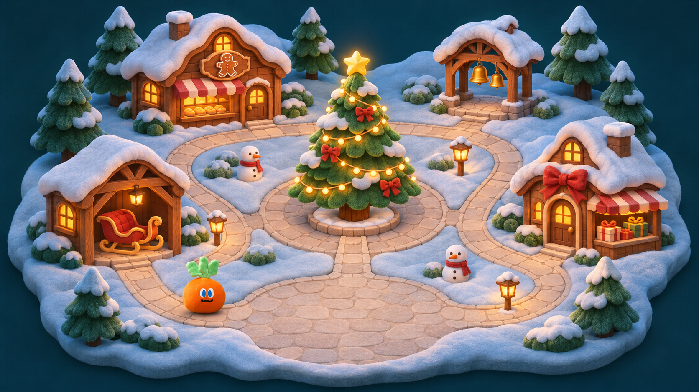
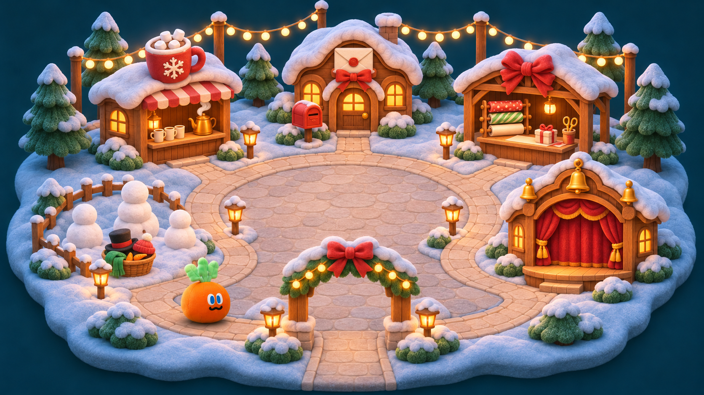
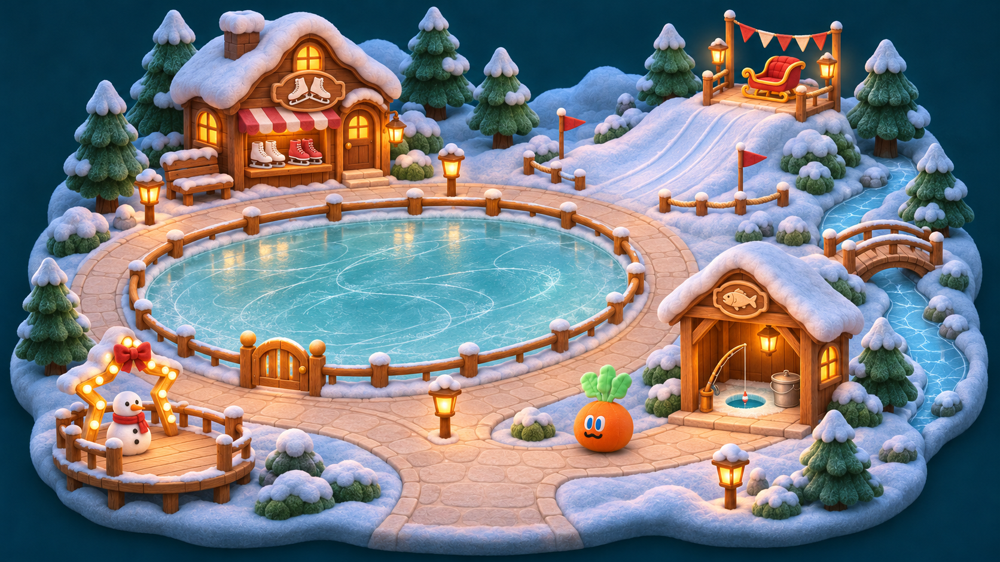
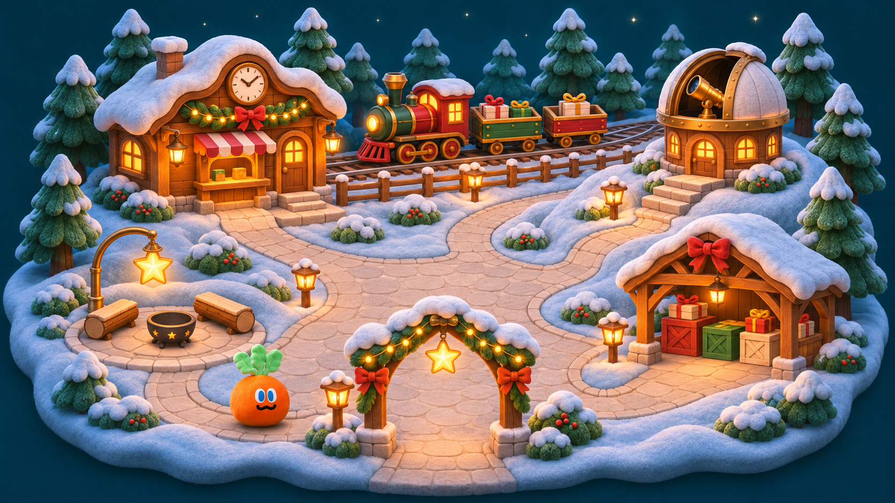

# 多场景规划

## 结构与范围

以已确认的中央圣诞小镇为主场景，增加圣诞集市、冰湖乐园、星光车站三个主题区域。所有区域采用统一的斜俯视角、微缩玩具材质、厚积雪、蓝青夜色和暖光。鼠标点击固定道路移动，角色采用单独制作的四方向 3/4 素材。

四个区域现已接入网页，可通过上方按钮切换探索。下表列出 17 个未来可承载玩法的候选点位，按实际需求逐项选择。中央圣诞树另作为公共中心。实际网页采用移除预绘角色后的底图与独立透明角色图集，并以底图裁切实现前景遮挡；独立灯光层在后续细化。

## 场景与点位

| 区域 | 点位 | 空间设计 | 未来可容纳的玩法方向 |
|---|---|---|---|
| 中央小镇 | 姜饼工坊 | 招牌、橱窗与门前停留区 | 拼图、烘焙装饰 |
| 中央小镇 | 礼物小屋 | 蝴蝶结与礼物展示 | 配对、礼物选择 |
| 中央小镇 | 雪橇驿站 | 停放雪橇的开放木棚 | 出发准备、配送入口 |
| 中央小镇 | 铃铛音乐亭 | 开敞铃铛亭 | 音序、节奏 |
| 圣诞集市 | 热可可摊 | 巨型杯子招牌、杯具与操作台 | 饮品调配、订单记忆 |
| 圣诞集市 | 圣诞邮局 | 信封招牌、邮箱和门前通道 | 祝福信、邮票收集 |
| 圣诞集市 | 礼物包装台 | 包装纸卷和宽台面 | 包装组合、颜色搭配 |
| 圣诞集市 | 雪人庭院 | 三个雪人胚与配件篮 | 换装、装饰 |
| 圣诞集市 | 木偶小舞台 | 红帘与宽舞台前空地 | 排序、短故事互动 |
| 冰湖乐园 | 冰场入口 | 围栏、木门和完整冰面 | 滑行、路径挑战 |
| 冰湖乐园 | 雪橇坡 | 独立起点、坡道和旗帜 | 躲避、下滑 |
| 冰湖乐园 | 冰钓小屋 | 檐下冰洞和钓具 | 时机、钓鱼 |
| 冰湖乐园 | 合影平台 | 星形灯框、雪人和围栏 | 拍照、贴纸装饰 |
| 星光车站 | 站房窗口 | 时钟、窗口与前场 | 车票、目的地选择 |
| 星光车站 | 货运棚 | 不同色箱体、宽操作区 | 分类、装车 |
| 星光车站 | 观星台 | 圆顶、望远镜与台阶 | 星座连线、寻找星星 |
| 星光车站 | 林间营地 | 圆形营地、长椅与星灯 | 故事、角色对话、寻物 |

冰鞋租赁屋作为冰湖的服务入口和气氛建筑，先与冰场合并为一个点位，避免重复堆叠玩法。

## 各场景设计

### 中央小镇

中央圣诞树是全镇视觉锚点。保留四个已定主题建筑和环形道路，后续在道路外缘设计前往其他区域的入口。角色默认出生在前景道路。

### 圣诞集市

以开放广场与环路组织五个点位。可可摊、邮局与包装台放在后侧，雪人庭院和小舞台分列前侧，前景花环门作为区域出入口。灯串形成顶部轮廓，中央空地可放临时摊位或季节性装饰。

### 冰湖乐园

冰面成为主视觉，环湖步道连接各入口，围栏明确区分湖面与行走道路。滑冰活动从木门进入独立空间。雪橇坡、冰钓屋与合影台各有清楚的门前落点。木桥和远侧溪流作为场景边界装饰。

### 星光车站

站房与列车位于后侧，货运棚、营地与观星台围绕中部通道。铁路通过围栏与角色步道分开。前景星灯拱门用于区域进出，右侧观星台带来不同的建筑轮廓和高低层次。

## 场景连接提案

中央小镇作为中转，分别连接三个区域，玩家在子区域从前景入口返回中央小镇。第一次接入时为中央小镇补充三个清楚的出口，具体位置随最终分层地图一起确定。

当前通过上方按钮切换区域，返回时恢复上次停留位置与朝向。新区域首次访问使用预设落点，载入后淡入。上述道路出口连接为后续扩展提案，入口拱门目前作为装饰通道。场景总览页用于查看四张设计图。

## 后续美术制作顺序

1. 确认三个新增区域的布局、点位数量与氛围。
2. 先将中央小镇拆为可用底图、建筑、树体与装饰层。
3. 接入正式主场景，校准道路与入口坐标、角色尺度及遮挡。
4. 按集市、冰湖、车站顺序逐个制作分层场景。
5. 完成场景连接与返回落点，再按需求选择点位填充玩法。

## 素材记录

三张新增概念图由内置 imagegen 生成，完整提示词见 [多场景生成记录](多场景生成记录.md)。当前图中部分角色角度仍接近正面，实际角色会使用已制作的四方向贴图。道路与建筑透视在分层制作时需要统一校准。
