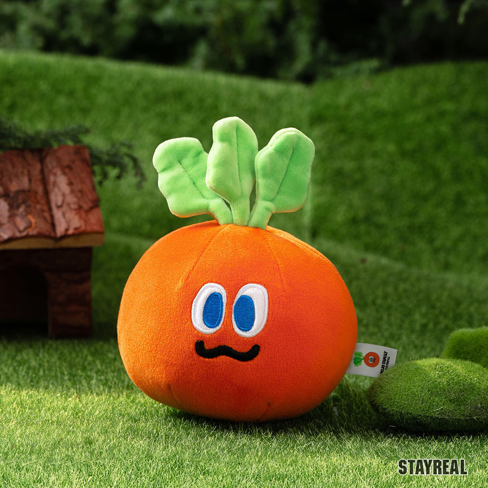

# 卜卜圣诞小镇角色参考

核对日期为 2026-11-19。项目采用 2.5D 小镇。以下名称和图片取自 STAYREAL 官方商品页，游戏职责为本项目创意设定。MOJO FAMILY 与五月天五位成员的逐一对应关系尚未获得官方资料确认。

## 卜卜基础形象

[魔魔胡胡胡蘿蔔小絨毛公仔](https://hkmall.istayreal.com/products/lf24002)

以这张基础款为本次角色校准基准。视觉观察为橙色横向饱满身体、三片带叶脉的大绿叶、白色眼白包围蓝色竖椭圆眼部、较粗的黑色波浪嘴。五官集中于身体正面中部。后续出图需输入官方参考图片并逐项核对身体轮廓、叶子形状与比例、眼白和蓝色眼部结构、嘴部曲线。此前概念图把眼睛画成带高光的深色眼睛、缩小嘴巴、添加粉色腮红，造成角色偏离。

## 角色清单

| 官方名称 | 官方参考 | 小镇职责构想 |
|---|---|---|
| 魔魔胡胡胡蘿蔔 | https://hkmall.istayreal.com/products/lf24002 | 玩家角色 |
| 四處流香香蕉哥 | https://hkmall.istayreal.com/products/lf24003 | 雪橇礼物运输 |
| 人仰馬番番茄君 | https://hkmall.istayreal.com/products/lf24007 | 姜饼工坊 |
| 雞犬不檸檸檬仔 | https://hkmall.istayreal.com/products/lf24004 | 彩灯连线 |
| 紅得發紫櫻桃姊妹 | https://hkmall.istayreal.com/products/lf24009 | 成对礼物配对 |
| 野蠻的甜青蘋果 | https://hkmall.istayreal.com/products/lf24011 | 雪地寻物 |
| 緊張西西西瓜哥 | https://hkmall.istayreal.com/products/lf24005 | 接住掉落礼物 |
| rabbit.Q 純真兔兔 | https://hkmall.istayreal.com/products/ld24002 | 邮局引导员候选 |

## 官方图片入口

## 官方圣诞造型参考

[圣诞卜卜树](https://hkmall.istayreal.com/products/ly25034)

[雪人卜卜](https://hkmall.istayreal.com/products/ly25033)

